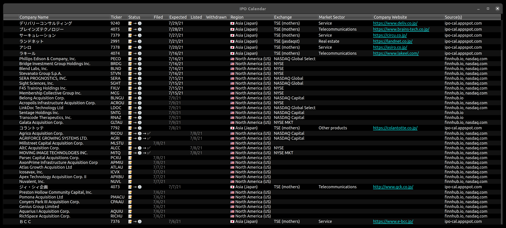

# IPO Stalker

Reminder system for upcoming IPOs.  Features automatic built-in scraping mechanism that aggregates data from multiple data sources.

## Data Sources

| Region | Marketplace | Name | Description |
|:-------|:------------|:-----|:------------|
| 🇺🇸 North America (US) | NASDAQ NYSE | `nasdaq.com` | Filed, upcoming, recently priced and withdrawn US IPOs |
| 🇺🇸 North America (US) | NASDAQ NYSE | `finnhub.io` 🔑 | Recently listed and upcoming US IPOs |
| 🇺🇸 North America (US) | OTC Markets | `otcbb.swingtradebot.com` | Recently listed OTC IPOs |
| 🇯🇵 East Asia (Japan) | TSE (Prime, Standard, Growth, TOKYO PRO) | `jpx.co.jp` | Recently listed and upcoming Japanese IPOs |
| 🇮🇳 South Asia (India) | NSE NSE Emerge (SME) | `nseindia.com` | Open, upcoming and recently listed Indian IPOs |
| 🇦🇺 Oceania (Australia) | ASX | `asx.com.au` | Upcoming Australian floats |
| 🇧🇪 Europe (Belgium) 🇫🇷 Europe (France) 🇮🇪 Europe (Ireland) 🇮🇹 Europe (Italy) 🇳🇱 Europe (Netherlands) 🇳🇴 Europe (Norway) 🇵🇹 Europe (Portugal) | Euronext Euronext Growth Euronext Access | `euronext.com` | Recently listed and upcoming European IPOs |

🔑 requires a free API key, see [Configuration](#configuration).

## Usage

* Double-click a row to flag it 🚩; flagged IPOs trigger a desktop notification 48 hours, 24 hours and 1 hour before their expected date
* Right-click a row to open the company website, copy the ticker, or see the record's history (which data source changed what and when)
* Click column headers to sort
* Closing the window hides it into the system tray; quit with <kbd>Ctrl</kbd>+<kbd>Q</kbd> or from the tray menu

## Build

Requirements: CMake 3.16+, a C++17 compiler, and Qt 6 (Core, Gui, Network, Sql with the SQLite driver, Widgets).
Qt 5.15 is still supported as a fallback when Qt 6 isn't installed.

    cmake -S . -B build -DCMAKE_BUILD_TYPE=Release
    cmake --build build --parallel

On Debian/Ubuntu the dependencies can be installed with:

    sudo apt install cmake g++ qt6-base-dev libgl-dev

For a debug build (prints scraper activity to the terminal) use `-DCMAKE_BUILD_TYPE=Debug`.

Offline tests for the scrapers' parsers and record merging:

    ctest --test-dir build --output-on-failure

## Install

    sudo cmake --install build

## Uninstall

    sudo cmake --build build --target uninstall

## Configuration

Settings live in `~/.config/ipo-stalker/ipo-stalker.ini` (Linux), along with the database (`ipo-stalker.sqlite`).

To enable the `finnhub.io` data source, [get an API key](https://finnhub.io/register) and add it to the settings file:

    [Secrets]
    finnhubApiKey=your_secret_finnhub_api_key

## Customize

Placing a file named `ipo-stalker.qss` into `~/.config/ipo-stalker/` will serve as custom stylesheet for the program.
You can use [ipo-stalker.qss](res/stylesheets/ipo-stalker.qss) for reference.
